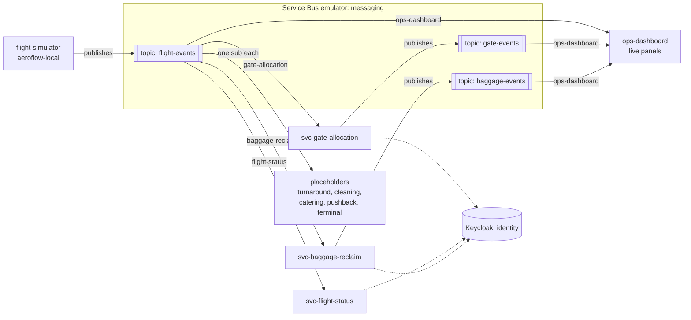
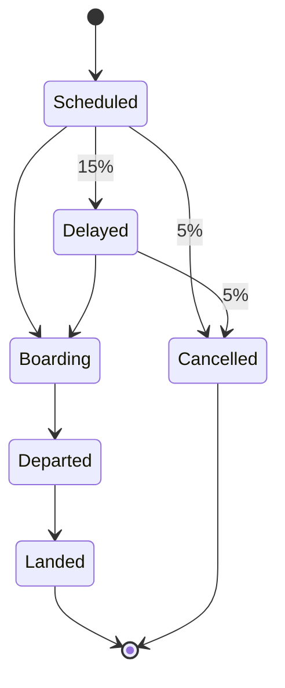
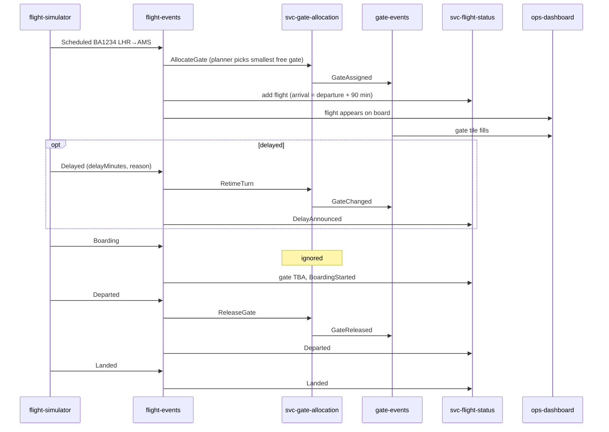
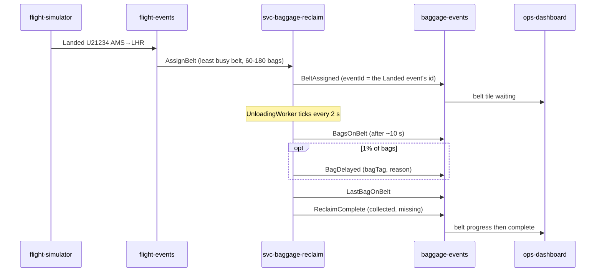

# AeroFlow airport: architecture and event flows

How the whole airport fits together today: which services exist, what they
listen to, what they publish, and where the gaps are. It describes the code on
`main` as of 2026-10-13 (aeroflow-local #9, svc-gate-allocation #8,
svc-baggage-reclaim #2). Each service's own detail lives in its `docs/service.md`
([standard](../standards/service-docs.md)).

## System context

AeroFlow runs locally as one .NET Aspire AppHost in
[`aeroflow-local`](https://github.com/aeroflow-air/aeroflow-local) (ADR-0014).
Nothing is deployed to Azure yet. The AppHost starts:

- the **Azure Service Bus emulator** (`messaging`), the event bus (ADR-0013);
- **Keycloak** (`identity`, port 8080), a free stand-in for Entra; services get
  the reference but none validates tokens yet;
- the **flight simulator**, which invents flights and publishes their lifecycle;
- three **real services** cloned as sibling repos, and placeholders for the rest;
- the **ops dashboard** (Blazor Server in aeroflow-local): live board, gates,
  belts and event stream driven by Service Bus listeners (#72, #73).

Services never call each other. Each reacts to events on topics, and each topic
is owned by the one service that publishes to it (ADR-0013).

## Services

| Service | Kind | Consumes | Publishes | HTTP API | Doc |
| --- | --- | --- | --- | --- | --- |
| flight-simulator | local tool (aeroflow-local) | none | `flight-events` | none | [aeroflow-local README](https://github.com/aeroflow-air/aeroflow-local) |
| [svc-gate-allocation](https://github.com/aeroflow-air/svc-gate-allocation) | real | `flight-events` / `gate-allocation` | `gate-events` | gates and allocations, Scalar | `docs/service.md` |
| [svc-flight-status](https://github.com/aeroflow-air/svc-flight-status) | real | `flight-events` / `flight-status` | none | flight lookup, departures and arrivals boards, manual events, Scalar | `docs/service.md` |
| [svc-baggage-reclaim](https://github.com/aeroflow-air/svc-baggage-reclaim) | real | `flight-events` / `baggage-reclaim` | `baggage-events` | `GET /belts` (rest of the API is #69) | `docs/service.md` |
| svc-turnaround, svc-cleaning, svc-catering, svc-pushback, svc-terminal | placeholder (aeroflow-local `src/placeholders`) | `flight-events` / own name | none | `/ping` | none; they log what they receive |
| ops-dashboard | real (aeroflow-local Blazor Server) | `flight-events`, `gate-events`, `baggage-events` / `ops-dashboard` | none | live board, gates, belts, event stream, health strip; reads the three services' APIs on startup (#74) | #53 |

All three real services keep state **in memory** and lose it on restart. Each
processes one message at a time (`MaxConcurrentCalls = 1`) with manual
completion. The ops dashboard holds an immutable in-memory `AirportView` and
re-renders when listeners apply events. On startup (and on its Refresh button) it
first loads flights, gates and belts from the services' read APIs through service
discovery, so a restart doesn't show an empty airport. Events then win over that
snapshot, and a service that is down is retried and named in the top bar (#74).

## Topics and subscriptions

Declared in `aeroflow-local/src/AeroFlow.Local.AppHost/AppHost.cs`.

| Topic | Owner (publisher) | Subscription (Aspire resource) | Reader |
| --- | --- | --- | --- |
| `flight-events` | flight-simulator | `local-dev` | nobody; for poking at with tools |
| | | `gate-allocation` (`sub-svc-gate-allocation`) | svc-gate-allocation |
| | | `flight-status` (`sub-svc-flight-status`) | svc-flight-status |
| | | `baggage-reclaim` (`sub-svc-baggage-reclaim`) | svc-baggage-reclaim |
| | | `ops-dashboard` | ops-dashboard |
| | | `svc-turnaround`, `svc-cleaning`, `svc-catering`, `svc-pushback`, `svc-terminal` | the placeholders |
| `gate-events` | svc-gate-allocation | `ops-dashboard` | ops-dashboard |
| `baggage-events` | svc-baggage-reclaim | `ops-dashboard` (`sub-baggage-ops-dashboard`) | ops-dashboard |

Every subscription gets its own copy of every message; there are no filters, so
each service decides in code what to ignore.

### Message conventions

All three topics use the same envelope: JSON body (web casing, enums as strings),
`MessageId` = event id, `Subject` = event type, `CorrelationId` = flight id,
`ContentType` = `application/json`. The simulator also sets application
properties `eventType` and `flightNumber`.

**`flight-events` body** (`AeroFlow.Local.FlightEvents.FlightEvent`):
`eventId`, `flightId` (`SIM-00001`), `flightNumber` (two-character airline +
digits, e.g. `U23456`), `eventType` (`Scheduled`, `Delayed`, `Boarding`,
`Departed`, `Landed`, `Cancelled`), `origin`, `destination`,
`scheduledDeparture`, `occurredAt`, optional `delayMinutes`, `reason`.

**`gate-events` body** (`AeroFlow.GateAllocation.Domain.GateEvent`):
`eventId`, `eventType` (`GateAssigned`, `GateChanged`, `GateReleased`),
`flightNumber`, `flightId`, `gate`, `occurredAt`, optional `previousGate`,
`onBlock`, `offBlock` (nulls omitted).

**`baggage-events` body** (`AeroFlow.BaggageReclaim.Domain.BaggageEvent`):
`eventId`, `eventType` (`BeltAssigned`, `BagsOnBelt`, `BagDelayed`,
`LastBagOnBelt`, `ReclaimComplete`), `flightId`, `flightNumber`, `belt`,
`occurredAt`, and when relevant `bagCount`, `bagsCollected`, `bagsMissing`,
`bagTag`, `reason` (nulls omitted).

## Flight lifecycle

The simulator's home airport is **LHR**. Each tick (5 s by default, seed 42) it
advances every active flight one step and may schedule a new one (up to 8 in
flight). Half the flights depart LHR, half arrive there.

Who reacts to what:

| Event | svc-gate-allocation (departures from LHR) | svc-flight-status (all flights) | svc-baggage-reclaim (arrivals to LHR) | ops-dashboard |
| --- | --- | --- | --- | --- |
| `Scheduled` | `AllocateGate` + `GateAssigned` | adds the flight | ignored | board / gates update |
| `Delayed` | `RetimeTurn` + `GateChanged` | `DelayAnnounced` | `RecordDelay` if it has a belt | delay on board |
| `Boarding` | ignored | assigns gate `TBA`, then `BoardingStarted` | ignored | boarding on board |
| `Departed` | `ReleaseGate` + `GateReleased` | `Departed` | ignored | clears gate |
| `Landed` | ignored | `Landed` | `AssignBelt` and starts unloading | arrivals / belts |
| `Cancelled` | `ReleaseGate` + `GateReleased` | `Cancelled` | `CancelReclaim` if it has a belt | removes flight |

## Baggage event flow

A 120-bag flight takes about 35 seconds from `Landed` to `ReclaimComplete` with
the default settings.

## Cross-cutting behaviour and failure modes

- **Delivery is at least once.** Only svc-baggage-reclaim is idempotent (it
  remembers the last 10,000 event ids). Gate allocation and flight status rely
  on domain rules to reject repeats (`already_allocated`, `invalid_transition`),
  which shows up as warnings, not duplicates. The ops dashboard de-duplicates on
  `EventId` in its projector.
- **Publishing is reliable** ([ADR-0017](../decisions/0017-reliable-event-publishing.md)).
  Gate allocation and baggage reclaim save outgoing events in the same atomic
  store update as the change (an outbox), and an `OutboxDispatcher` sends them
  in order, retrying until the bus accepts them. Event ids are deterministic, and
  every topic has duplicate detection on, so a re-send is dropped by the bus or
  by the consumer.
- **Business rejections are completed, not retried.** They are logged as
  warnings such as `no_gate_available` once the six open demo gates are full,
  or `flight_not_found` for flights scheduled before a service started.
- **Unreadable messages are dead-lettered** with reason `unreadable`. Messages
  in a dead-letter queue almost always mean the contract copies have drifted
  (see #71).
- **Messaging is optional.** Each processor starts only when a `messaging`
  connection string exists, so `dotnet run`, containers and tests work without
  the bus.
- **Restart loses state** in every service and the dashboard, and the simulator
  restarts its sequence, so after restarting one service it sees events for
  flights it never saw scheduled. The dashboard reloads what the services still
  hold from their APIs (#74), but if a service restarted too, that state is gone.
- **Unread subscriptions grow**: `local-dev` still has no reader.

## Known gaps

| Gap | Effect | Tracked |
| --- | --- | --- |
| Placeholder gate `TBA` | flight status invents it at `Boarding` so the domain rule "boarding needs a gate" passes; it does not subscribe to `gate-events` yet | follow-on to #77 |
| Event contracts are local copies in each service (`FlightEventMessage`, gate and baggage copies in the dashboard) | a change to the simulator can silently break consumers (dead letters) | [#71](https://github.com/aeroflow-air/platform-handbook/issues/71) |
| `workload.yaml` cannot declare topics or subscriptions | the paved road cannot provision the bus; everything above exists only in the AppHost | [#64](https://github.com/aeroflow-air/platform-handbook/issues/64) |
| Gate allocation ignores arrivals; every turn is aircraft size C | no gates for inbound aircraft | |
| Baggage reclaim API | only `GET /belts`; no single belt, flight reclaim or bag lookup yet | [#69](https://github.com/aeroflow-air/platform-handbook/issues/69) |
| Richer board / journey UI | flash on change, closed gates, stream filter, flight journey | [#75](https://github.com/aeroflow-air/platform-handbook/issues/75), [#76](https://github.com/aeroflow-air/platform-handbook/issues/76) |
| State in memory only | everything resets on restart | |
| Keycloak not enforced | services get the reference but accept anonymous calls | |

## Decisions this rests on

- [ADR-0004 Functional-style C#](../decisions/0004-functional-style-csharp.md): pure domain, `Result` and `Option`.
- [ADR-0007 Container Apps hosting](../decisions/0007-container-apps-hosting.md)
- [ADR-0009 Workload manifest](../decisions/0009-workload-manifest.md) and the [design doc](../design/workload-manifest-platform.md)
- [ADR-0013 Central event bus](../decisions/0013-central-event-bus.md) (draft): one topic per owning service.
- [ADR-0014 .NET Aspire for local development](../decisions/0014-aspire-local-development.md) (draft)
- [ADR-0015 API documentation with OpenAPI and Scalar](../decisions/0015-api-documentation-openapi-scalar.md) (draft)
- [Service docs standard](../standards/service-docs.md)

Keep this page current: a PR that adds a topic, a subscription or a service
updates it.
