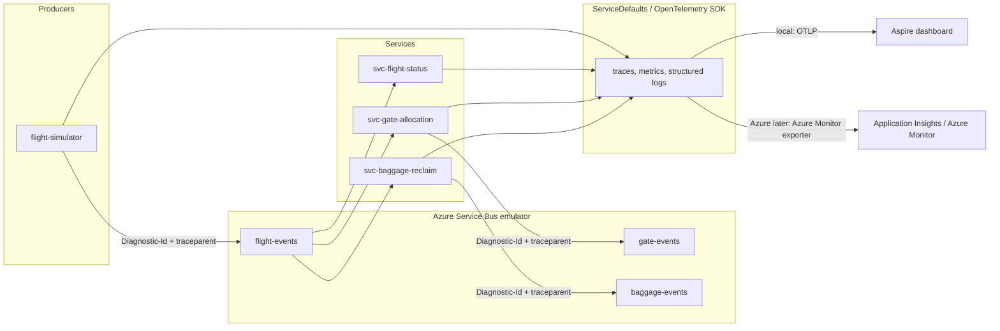

# Design: observability on the golden path

Status: proposed (this PR). Owner: Platform. Last checked against the repos on 21 November 2026. No Azure deployment yet.

This page is the design behind [ADR-0022](../decisions/0022-observability-on-the-golden-path.md). The decision record is the short version of what was chosen; this page explains how the pieces fit, what a squad writes, and what we would implement later. It does not change the workload schema or the generator.

## 1. The problem and the principle

Every service already needs traces, metrics, structured logs and health checks. If each squad wires those by hand, you get many slightly different exporters, attribute names and log formats, and the story of one flight cannot be followed across services. The platform's answer is the same principle as the workload manifest: **a service declares what it is, and the platform makes it observable.**

Observability is on by default on the golden path, not bolted on after an outage, and not a capability a service can forget to request.

What already exists, and what does not:

- `AeroFlow.Local.ServiceDefaults` in [aeroflow-local](https://github.com/aeroflow-air/aeroflow-local) already wires OpenTelemetry traces, metrics and logs, exports OTLP when `OTEL_EXPORTER_OTLP_ENDPOINT` is set, maps `/health` and `/alive`, and leaves an Azure Monitor exporter commented for `APPLICATIONINSIGHTS_CONNECTION_STRING`. The Aspire dashboard is the local backend ([ADR-0014](../decisions/0014-aspire-local-development.md), [ADR-0016](../decisions/0016-ops-dashboard-blazor-server.md)).
- The flight simulator enables `Azure.Experimental.EnableActivitySource` and starts a producer span around each tick, so the Service Bus SDK can attach `Diagnostic-Id`.
- `template-dotnet-service` and the real `svc-*` services do **not** reference ServiceDefaults. Each still has a commented OpenTelemetry stub. Template issues #8 (tracing and metrics), #10 (structured logs with trace correlation) and #14 (liveness and readiness) are still open. [ADR-0014](../decisions/0014-aspire-local-development.md) left open whether ServiceDefaults is copied, packaged or submodule'd from the template.
- Publishers already set `MessageId`, `Subject` and `CorrelationId` (the flight id, [ADR-0017](../decisions/0017-reliable-event-publishing.md)) but do not emit or restore W3C trace context. [ADR-0013](../decisions/0013-central-event-bus.md) already requires that context so one flight is one trace.
- [ADR-0007](../decisions/0007-container-apps-hosting.md) plans one Container Apps environment and a platform Log Analytics workspace that services use as `existing`. Today's `container-app-service` stand-in still creates a workspace and an environment per app. There is no Azure deployment and no personal subscription; nothing in this page authorises Azure spend.

## 2. Telemetry flow

One flight should be one distributed trace: simulator to Service Bus to the consuming services, and on again when those services publish `gate-events` or `baggage-events`.



`CorrelationId` stays the flight id, so a reader without a trace explorer can still stitch the same story from logs and Service Bus messages.

The outbox in [ADR-0017](../decisions/0017-reliable-event-publishing.md) matters here. Gate and baggage events are often sent later, by `OutboxDispatcher`, after the inbound consumer activity has ended. The outbox record must store the trace context captured when the event was written, and the dispatcher must restore it before `SendMessageAsync`. Otherwise the outbound message starts a new, disconnected trace.

## 3. The shared package

The existing ServiceDefaults project is the starting point, not a second invent. It already:

- calls `ConfigureOpenTelemetry()` for traces, metrics and OpenTelemetry logging (formatted message and scopes included)
- instruments ASP.NET Core, `HttpClient` and the runtime
- excludes `/health` and `/alive` from traces
- exports OTLP when `OTEL_EXPORTER_OTLP_ENDPOINT` is set
- leaves `UseAzureMonitor()` ready for a connection string
- registers a `self` liveness check and, in Development only, maps `/health` and `/alive`

It should be promoted to a small, independently versioned library (working name `lib-service-defaults`, published as a package) and referenced by `template-dotnet-service`, every `svc-*` and aeroflow-local. Services call `AddServiceDefaults()` and `MapDefaultEndpoints()`. That is also how placeholders in aeroflow-local work today.

This follows the handbook scaffolding line in `CLAUDE.md` (template plus small libraries for health checks, OTel at startup and structured logging) and closes the packaging question ADR-0014 left open. The design test still holds: a squad can delete the package and still ship, provided it meets the contract in section 8. We do not copy the project into every repo; copies drift, which is how the commented stubs happened.

The package should also, in a later implementation:

- set the required resource attributes from configuration the AppHost or the generator already knows
- enable `Azure.Experimental.EnableActivitySource` so Service Bus spans and `Diagnostic-Id` injection work without each service remembering the switch
- turn on the Azure Monitor exporter when `APPLICATIONINSIGHTS_CONNECTION_STRING` is present, instead of leaving it commented
- map `/health` and `/alive` in every environment, not only Development, so Container Apps probes work (see section 7)
- add Service Bus / messaging instrumentation and the consumer signals in section 4

## 4. Standard signals and attributes

Names follow OpenTelemetry semantic conventions where they exist. Custom names take an `aeroflow.` prefix.

**HTTP (RED).** Every HTTP service emits rate, errors and duration. Prefer the current HTTP conventions (`http.server.request.duration` and the associated counters/status attributes) over inventing `http_requests_total`. Success is a non-5xx response; 4xx is a client error, not a service error, unless a later SLO says otherwise.

**Consumers.** Every Service Bus consumer exposes:

- queue (subscription) depth
- message age (how long the oldest unsettled or arriving message has been waiting)
- dead-letter count

Locally these are application metrics, because the emulator does not give us Azure Monitor resource metrics. In Azure, prefer the Service Bus platform metrics for depth, age and dead letters, and keep the application traces and RED signals in Application Insights. A consumer still records its own handle duration and outcome (applied, rejected, ignored, dead-lettered) as a span and a log, so the Aspire dashboard has something to show.

**Resource attributes**, required on every signal:

| Attribute | Source |
|-----------|--------|
| `service.name` | Workload / Aspire resource name (`svc-gate-allocation`, `flight-simulator`) |
| `service.version` | Image tag or assembly informational version (git SHA is fine) |
| `deployment.environment` | `local` now; a future Azure environment name later |
| `aeroflow.squad` | Owning squad (the service-doc Owner) |

**Cardinality.** Flight id and flight number are operational identifiers, not PII. They belong on traces and on structured log properties. They must not be metric dimensions. High-cardinality values (message ids, raw URLs with query strings, exception messages) stay off metrics too.

## 5. Logging rules

These sit on top of [ADR-0004](../decisions/0004-functional-style-csharp.md) and the [coding standards](../standards/coding-standards.md). They are not a new style.

- **Pure domain code does no logging.** No `ILogger`, no `Console`, no `Activity` in `Domain`. Side effects stay at the edges: controllers, Service Bus processors, publishers, stores, workers. If a domain decision needs to be visible, the edge logs it after `Match` on the `Result`.
- **Structured, source-generated logs.** `ILogger` with `[LoggerMessage]` and named placeholders, as the processors already do. No interpolated string templates in hot paths.
- **Levels.** `Information` for a request or event that was applied; `Warning` for a business rejection, a dead letter or a retried publish; `Error` for unexpected failures. `Debug` is local-only and is not exported to Azure at the default level. `Trace` is not used on the golden path.
- **Correlation.** Log records go through OpenTelemetry logging, so they carry the current trace and span id. The flight id is a named property when the edge has one.
- **No PII, no secrets.** No passenger names, emails, phone numbers, tokens, connection strings, `Authorization` headers or request bodies. Flight number and flight id are allowed. If a value should not appear in a public GitHub issue, it should not appear in a log.

## 6. Sampling and cost

There is no Azure deployment yet, so these are the rules for when a subscription exists, plus what we do locally now.

- **Local: no sampling.** The demo is useless if the Aspire dashboard hides the one flight you are watching.
- **Azure: platform defaults, not per-service taste.** A parent-based sampler with a head-sample ratio the platform sets. Errors (`ActivityStatusCode.Error`, unhandled exceptions, failed publishes) are always sampled. A service must not raise its own ratio to "debug this in production".
- **While traffic is still a showcase,** 100% sampling in Azure is an acceptable platform setting. It is not a permanent policy. A daily cap on the workspace or Application Insights resource is part of standing the environment up, alongside the budget alert ADR-0007 already includes in bootstrap.
- **Logs and metrics.** Default Azure log level is `Information`. Metric cardinality stays under the rule in section 4. The shared workspace ADR-0007 planned is cheaper and more useful than a workspace per service; that stand-in should not become the production shape.

This is the same spirit as ADR-0013: publish the destination and the controls, and do not provision until spend is explicitly authorised.

## 7. Health checks

ServiceDefaults already distinguishes liveness and readiness. The golden path is:

| Endpoint | Meaning | Checks |
|----------|---------|--------|
| `/alive` | Liveness. The process should not be restarted if this passes. | The existing `self` check only. |
| `/health` | Readiness. The replica should not receive traffic if this fails. | `self`, plus configured dependencies (Service Bus when a `messaging` connection is wired). |

Both are mapped in every environment, not only Development. Container Apps probes hit the container port; if the endpoints exist only in Development, a deployed replica cannot be probed. Both stay anonymous ([ADR-0018](../decisions/0018-entra-id-authentication-authorisation.md)). Both stay out of traces, as they already are, so probe traffic does not drown the dashboard.

A missing Service Bus connection on a lone `dotnet run` or in unit tests must not fail startup; that is already how the services behave. Readiness only checks dependencies that are actually configured.

## 8. Opinions, non-negotiables and escape hatches

**Non-negotiable** (a PR that does the opposite is off the golden path):

- Traces, metrics and structured logs are emitted. Health endpoints exist. W3C context travels on every Service Bus message, including outbox sends.
- The standard signals and required resource attributes in section 4 are present.
- Domain code stays free of logging and other side effects.
- Logs and attributes contain no PII or secrets.
- Sampling, exporters and daily caps are platform defaults.
- In Azure, telemetry goes to the platform's workspace-based Application Insights, not to a squad-owned workspace or a second vendor.

**Default, with a narrow escape hatch:**

- Services use the shared ServiceDefaults package. The hatch is to replace the package, not the contract: a squad may wire the SDK itself if the package cannot support the runtime, and review asks the same questions it would of the package.
- HTTP instrumented automatically; messaging instrumented by the package plus a small amount of edge code (publisher/processor helpers). A service may add its own spans at the edges (for example a named "allocate gate" span around a domain call) but not inside the domain.
- Optional SLOs in `workload.yaml`. A service without the block is still observable; it just has no generated alerts yet. Dead-letter count greater than zero on a declared subscription is a platform default alert once Azure exists, whether or not an SLO was written.

**Not this platform, unless a later ADR says so:** Grafana or a vendor APM as the primary destination; an OpenTelemetry Collector sidecar on every app; Dapr observability; making observability a capability that can be omitted; per-service Log Analytics workspaces as the target shape.

## 9. What a squad must document

The [service docs standard](../standards/service-docs.md) already requires a **Failure modes** section: how each failure shows up (log line, HTTP status, dead-letter, missing event), its impact and what to do, plus delivery semantics. **Running and testing** already asks what healthy logs look like.

That stays. A later change to the standard should add a **Signals** section, kept in every `docs/service.md`, covering:

- the HTTP RED signals and any service-specific ones
- for consumers: topic, subscription, and the depth / age / dead-letter signals
- the SLO names declared in `workload.yaml`, if any
- a short note on what a healthy trace for one flight looks like (which services, which spans)

The existing Failure modes table remains the place to tie a failure to the log line or dead-letter reason you would actually search for. Reviewers already treat an updated `docs/service.md` as part of the definition of done when inputs, outputs or failure paths change; signals follow the same rule.

## 10. SLOs in `workload.yaml` — proposed shape

This is a design proposal only. The schema in `aeroflow-workflows` still rejects unknown keys. Neither generator is changed in this PR. When it is implemented, both `generate.py` and `generate.cs` must keep golden-file parity ([ADR-0021](../decisions/0021-csharp-workload-generator.md)).

Observability is always on. The new block is optional and only declares SLOs (and, later, the alerts those SLOs become). It is not a new capability.

```yaml
workload: svc-gate-allocation
repo: svc-gate-allocation
dataClass: internal
capabilities: [http, queue]
events:
  publishes: [gate-events]
  subscribes:
    - topic: flight-events
      subscription: gate-allocation
observability:
  slos:
    - name: http-availability
      description: HTTP requests succeed
      signal: http
      objective: availability
      target: 99.9          # percent of requests that are not 5xx
      window: 30d
    - name: http-latency
      description: Read API stays quick
      signal: http
      objective: latency
      percentile: p99
      threshold: 500ms
      target: 99            # percent of requests under the threshold
      window: 30d
    - name: flight-events-freshness
      description: Incoming flight events are handled promptly
      signal: queue
      objective: message-age
      topic: flight-events
      subscription: gate-allocation
      threshold: 60s
      target: 99
      window: 1h
```

Rules the schema and generator should enforce when this is built:

- `observability` is optional. `slos` is an array; if the block is present it must contain at least one SLO.
- `name` is unique within the workload, lowercase hyphenated, and stable: it becomes the alert name.
- `signal` is `http` or `queue`. `objective` is one of `availability`, `latency`, `message-age`, `dead-letter-count`, `queue-depth`.
- `queue` objectives must name a `topic` and `subscription` the workload already declares under `events.subscribes`.
- `target` is a percentage (0–100, one decimal place allowed). `window` is a duration (`1h`, `1d`, `7d`, `30d`). `threshold` is a duration or, for `queue-depth` and `dead-letter-count`, a non-negative integer.
- Unknown keys are rejected, as they are in the rest of the manifest (ADR-0009).

**Generator behaviour, when Azure deploy exists:**

1. Every workload, with or without the block, is wired to the platform Log Analytics workspace and the environment's workspace-based Application Insights resource (used as `existing`, in the same way ADR-0007 already describes the environment). The module injects `APPLICATIONINSIGHTS_CONNECTION_STRING` (and the resource attributes) into the container app. Squads do not put that connection string in `appsettings`.
2. Each SLO becomes an Azure Monitor alert (metric or scheduled-query, via a governed `br/platform:*` module, pinned like `hosting`). A standard workbook per environment shows RED, consumer signals and SLO burn.
3. Each declared subscription also gets a default dead-letter alert (`dead-letter-count > 0`) even when no SLO mentions it.
4. Invalid SLOs fail the same way invalid capabilities do: schema or generator error, no Bicep artifact.
5. Until there is a subscription and an authorised deploy, the generator may validate the block and emit no Azure resources. That is a later implementation choice, not a reason to invent a side channel.

## 11. Follow-up implementation

Draft titles only. This page does not open issues.

1. Extract ServiceDefaults into a versioned shared package and adopt it in `template-dotnet-service`.
2. Roll the ServiceDefaults package into `svc-flight-status`, `svc-gate-allocation` and `svc-baggage-reclaim`.
3. Propagate W3C trace context on Service Bus publish and consume, including outbox restores.
4. Emit standard consumer signals (queue depth, message age, dead-letter count) from the shared messaging helpers.
5. Map `/health` and `/alive` in every environment and add readiness checks for configured dependencies.
6. Add the optional `observability` / `slos` block to `workload.schema.json` and both generators, with golden-file parity.
7. Extend infra-platform: shared Log Analytics workspace and workspace-based Application Insights as `existing`; inject the connection string; generate alerts and the standard workbook from SLOs.
8. Add a Signals section to the service-docs standard and the `docs/service.md` template, and back-fill the three live services.

Items 6 and 7 wait on an explicit decision to spend on Azure, in the same way the Service Bus namespace does. The package, context propagation, consumer signals, health endpoints and service-doc updates do not.

## Related records

- [ADR-0004](../decisions/0004-functional-style-csharp.md) — functional-style C#; side effects at the edges
- [ADR-0007](../decisions/0007-container-apps-hosting.md) — Container Apps; shared environment and Log Analytics
- [ADR-0009](../decisions/0009-workload-manifest.md) — workload manifest as the paved road
- [ADR-0013](../decisions/0013-central-event-bus.md) — Service Bus topics; trace context on every message
- [ADR-0014](../decisions/0014-aspire-local-development.md) — Aspire for local development; ServiceDefaults
- [ADR-0016](../decisions/0016-ops-dashboard-blazor-server.md) — ops dashboard; Aspire remains the telemetry surface
- [ADR-0017](../decisions/0017-reliable-event-publishing.md) — outbox and deterministic event ids
- [ADR-0018](../decisions/0018-entra-id-authentication-authorisation.md) — `/health` stays anonymous
- [ADR-0021](../decisions/0021-csharp-workload-generator.md) — both generators, golden-file parity
- [ADR-0022](../decisions/0022-observability-on-the-golden-path.md) — the decision this page supports
- [Service docs standard](../standards/service-docs.md)
- [C# coding standards](../standards/coding-standards.md)
