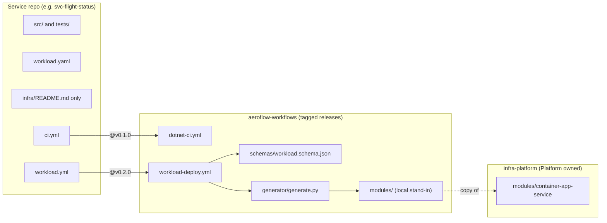
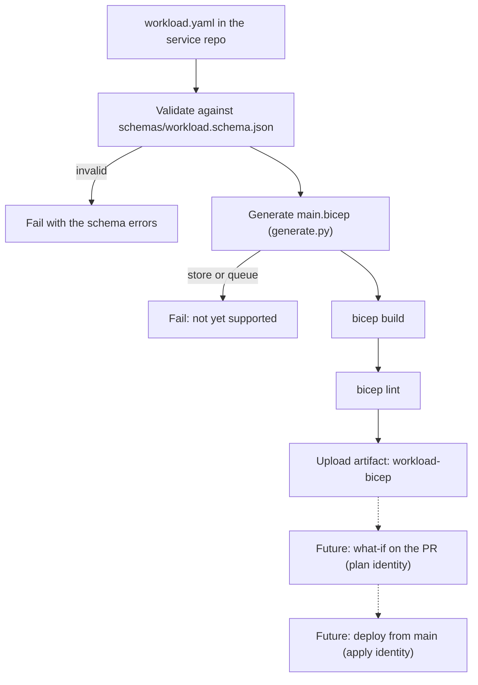
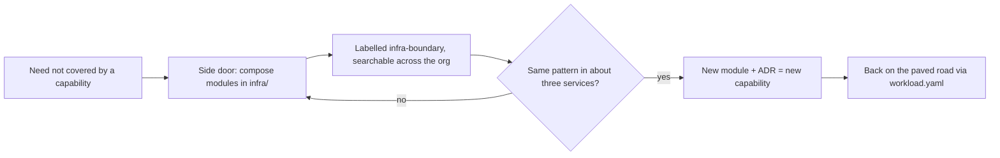

# Design: the workload manifest platform

Status: in use for `http` and `identity`, no Azure deployment yet. Owner: Platform. Last checked against the repos on 11 October 2026.

This page explains how an AeroFlow service gets its infrastructure. It is written for a new squad engineer, and for anyone reading the AeroFlow project to see how the platform is put together. The decisions behind it are in the decision records linked at the end. This page explains how the pieces fit; the records say what was decided.

## 1. The problem and the principle

Every service needs much the same infrastructure: somewhere to run, an identity, logs, and an HTTP endpoint. If each squad writes that by hand, you get many slightly different versions of the same thing, each with its own naming, tagging, security settings and mistakes. Reviewing them is slow, and a platform-wide fix means touching every repo.

AeroFlow's answer is one principle: **a service declares what it needs, and the platform builds it.**

A squad writes a short `workload.yaml` saying, for example, "I am an internal HTTP service". It does not say which Azure resources to create. The platform turns that request into Bicep made only from governed modules, so every service gets the same naming, tags, identity and diagnostics. Standards are applied once, in the platform, rather than remembered in every repo. That is what lets a small platform team keep many services consistent.

The done test from [ADR-0009](../decisions/0009-workload-manifest.md) is simple: a new service can be built without writing a `resource` block.

## 2. What lives where

Three kinds of repo take part.



**The service repo** holds the application code and, at its root, `workload.yaml`. Its `infra/` folder holds only a README, on purpose: there is no hand-written Bicep on the normal route. Its `.github/workflows/` folder holds thin callers that contain no real logic:

- `ci.yml` calls `aeroflow-workflows/.github/workflows/dotnet-ci.yml@v0.1.0` to restore, build and test.
- `workload.yml` calls `aeroflow-workflows/.github/workflows/workload-deploy.yml@v0.2.0`, passing `workflows_ref: v0.2.0` so the scripts it loads match the workflow version.

**aeroflow-workflows** holds the shared machinery, released as tags:

- `schemas/workload.schema.json`, the JSON Schema for `workload.yaml`.
- `generator/generate.py`, which validates a manifest and writes the Bicep.
- `modules/container-app-service/`, a local stand-in for the real module (see section 7).
- The reusable workflows, including `dotnet-ci.yml` and `workload-deploy.yml`.
- A self-test workflow that proves all of the above on every pull request, before a tag is cut.

**infra-platform** holds the governed Bicep modules, owned by Platform. Today it has one: `container-app-service`, which creates a Log Analytics workspace, a Container Apps environment and a container app with a system-assigned managed identity, scale to zero, and ingress on port 8080. It is not yet published to a registry.

## 3. The flow, end to end

When a service opens a pull request, `workload.yml` runs the shared workflow. The steps are:



Everything up to the artifact runs today, inside GitHub Actions, with no Azure login. The Bicep CLI is installed as a standalone binary (v0.47.16, the same version infra-platform builds with). The generated Bicep is uploaded as a build artifact and is not committed to the service repo, as ADR-0009 requires, so it can never drift from the generator. The dotted steps are not built; the workflow carries a TODO marking where they go.

## 4. Walkthrough: flight status

This is the real `workload.yaml` at the root of svc-flight-status, without its header comment:

```yaml
workload: svc-flight-status
repo: svc-flight-status
dataClass: internal
capabilities: [http]
```

Field by field, as the schema defines them:

| Field | Required | Meaning |
| --- | --- | --- |
| `workload` | yes | The workload name. The generator also uses it to name the container app, so it must be 2 to 28 lowercase letters, numbers or hyphens. |
| `repo` | yes | The repo that owns the workload. |
| `dataClass` | yes | `public`, `internal` or `confidential`. ADR-0009 plans to key human approval on `confidential`. |
| `capabilities` | yes | What the service needs, from a fixed list: `http`, `identity`, `store`, `queue`. No duplicates. |
| `modules` | no | Exact module pins. Only `hosting` is allowed, as `br/platform:<module>:<x.y.z>` or `br:ghcr.io/aeroflow-air/<module>:<x.y.z>`. |

Any other key is rejected. That is deliberate: you cannot sneak a raw resource or a block of Bicep into the manifest.

From that file, the generator writes (trimmed):

```bicep
targetScope = 'resourceGroup'

param location string = resourceGroup().location
param containerImage string
@allowed(['external', 'internal'])
param ingress string = 'internal'

module hosting '<container-app-service reference>' = {
  name: 'svc-flight-status-hosting'
  params: {
    name: 'svc-flight-status'
    location: location
    containerImage: containerImage
    ingress: ingress
  }
}
```

Notice what is not there: no `resource` blocks, no naming rules, no tags, no identity settings. Those all live inside `container-app-service`. The service only supplies the few values that genuinely differ between services. In CI today the module reference is a relative path to the local stand-in; once a version is published it will be the pin, for example `br/platform:container-app-service:0.1.0`.

The capability mapping today is:

| Capability | Module | Notes |
| --- | --- | --- |
| `http` | `container-app-service` | Required today. Ingress is internal by default. |
| `identity` | `container-app-service` | Provided by the module's system-assigned managed identity. |
| `store`, `queue` | none yet | The generator fails with "not yet supported". |

## 5. Versioning and rollout

Callers pin tags, never `main`. A service names both the workflow version (`@v0.2.0`) and the matching `workflows_ref`, so the schema, generator and stand-in it runs are exactly the ones in that release.

This matters because the generator is shared code. A change to it is released as a new tag in aeroflow-workflows after its self-test passes. Nothing changes for any service until that service moves its pin, in its own pull request, where its own CI shows the result. So a generator change rolls out service by service, with each squad able to see the effect before merging, and an old tag keeps working for anyone not ready to move. Module versions follow the same idea: exact pins, never overwritten ([ADR-0006](../decisions/0006-governed-bicep-modules-only.md)), with upgrades proposed as automated pull requests ([module upgrades](../infrastructure/module-upgrades.md)).

## 6. The side door, and how it feeds back

Not every need will fit the capabilities on offer. ADR-0009 keeps a guarded side door: a squad may hand-compose governed `br/platform:*` modules in its own `infra/` folder, as [ADR-0006](../decisions/0006-governed-bicep-modules-only.md) allows. Raw resources and Azure Verified Modules stay out of service repos. Agents never use the side door; [ADR-0008](../decisions/0008-agents-request-infrastructure.md) limits them to changing the manifest.

The guard is planned in stages. First, a `CODEOWNERS` entry for `infra/` requesting the owning squad's review, and an `infra-boundary` label applied automatically. Later, once squads have a second member, code-owner review becomes required. Neither is in place in svc-flight-status yet.



The side door is a source of discovery, not a failure. When roughly three services compose the same thing, that becomes a module and a capability, and those services move back to the manifest.

## 7. Status today versus later

| Area | Today | Later |
| --- | --- | --- |
| Capabilities | `http` and `identity` generate | `store` and `queue` once modules and ADRs exist |
| Modules | Local stand-in in aeroflow-workflows, a copy of infra-platform's `container-app-service` | infra-platform publishes a version; manifests pin it and the stand-in is deleted |
| Azure | None. No login, no what-if, no deployment | A personal Azure account, Tony's approval, and the plan and apply identities from [ADR-0010](../decisions/0010-plan-and-apply-identities.md) |
| Services | svc-flight-status calls `workload-deploy.yml@v0.2.0` | Other services and the template adopt it |
| Guard on `infra/` | Not in place | `CODEOWNERS` and the `infra-boundary` label |

ADR-0010 keeps plan and apply separate: a pull request may only use a read-only plan identity for what-if, and only the shared deploy workflow may apply.

## 8. Trade-offs

- **The generator is a shared dependency.** A bug in it reaches every service. That is why it has unit tests, golden-file tests, a self-test, tagged releases and service-by-service rollout.
- **Squads are limited to the capabilities on offer.** If you need something new, you wait for a module or use the side door. That friction is intended; the feedback loop is how the list grows.
- **Reviewers see YAML, not resources.** A one-line manifest change can create real infrastructure. The planned fix is to post the what-if result on the pull request, using the plan identity, so reviewers see exactly what will change.
- **Shared resources need a home.** Things used by many services, such as a registry or the identity with `AcrPull` from [ADR-0007](../decisions/0007-container-apps-hosting.md), do not belong in any one manifest. They live in a platform stack owned by Platform.

## 9. How it compares

The pattern is not new. Other tools make the same promise in different ways.

- **Kratix Promises** run inside Kubernetes. A Promise defines a custom resource as the API, a pipeline that runs on each request, and destinations the output is written to, with a controller reconciling continuously.
- **Score** is a platform-neutral workload specification. A `score.yaml` describes a workload and its dependencies, and an implementation such as score-compose or score-k8s turns it into concrete configuration.
- **Radius** describes applications and their connections to resources, with recipes supplying the infrastructure. It runs its control plane on Kubernetes.

AeroFlow targets only Azure Container Apps, has no Kubernetes cluster to host a controller, and has a very small team. A generator that runs in CI fits that: it costs nothing to run, needs no always-on service, uses Bicep and GitHub Actions the team already uses ([ADR-0006](../decisions/0006-governed-bicep-modules-only.md) and [ADR-0007](../decisions/0007-container-apps-hosting.md)), and is easy to read end to end. The cost is that nothing reconciles drift continuously; deployments will rely on what-if and on Bicep deployment from a single workflow instead. If AeroFlow ever adopts Kubernetes or several clouds, Kratix, Score or Radius would be worth revisiting.

## 10. References

Decision records:

- [ADR-0002](../decisions/0002-infrastructure-as-code-bicep.md): Bicep for infrastructure as code (superseded by ADR-0006, kept for history)
- [ADR-0006](../decisions/0006-governed-bicep-modules-only.md): squads self-serve through governed Bicep modules only
- [ADR-0007](../decisions/0007-container-apps-hosting.md): service hosting on Azure Container Apps
- [ADR-0008](../decisions/0008-agents-request-infrastructure.md): agents request infrastructure through a manifest
- [ADR-0009](../decisions/0009-workload-manifest.md): the workload manifest as the paved road, with a guarded side door
- [ADR-0010](../decisions/0010-plan-and-apply-identities.md): separate plan and apply identities

Pull requests:

- aeroflow-workflows [#4](https://github.com/aeroflow-air/aeroflow-workflows/pull/4) and [#5](https://github.com/aeroflow-air/aeroflow-workflows/pull/5): the workload schema
- aeroflow-workflows [#7](https://github.com/aeroflow-air/aeroflow-workflows/pull/7): the generator, local stand-in and `workload-deploy.yml`, released as `v0.2.0`
- infra-platform [#1](https://github.com/aeroflow-air/infra-platform/pull/1) and [#2](https://github.com/aeroflow-air/infra-platform/pull/2): `container-app-service` and its GHCR publish workflow
- svc-flight-status [#5](https://github.com/aeroflow-air/svc-flight-status/pull/5): `workload.yaml`
- svc-flight-status [#8](https://github.com/aeroflow-air/svc-flight-status/pull/8): calls `workload-deploy.yml@v0.2.0`
- platform-handbook [#58](https://github.com/aeroflow-air/platform-handbook/issues/58): the generator issue
